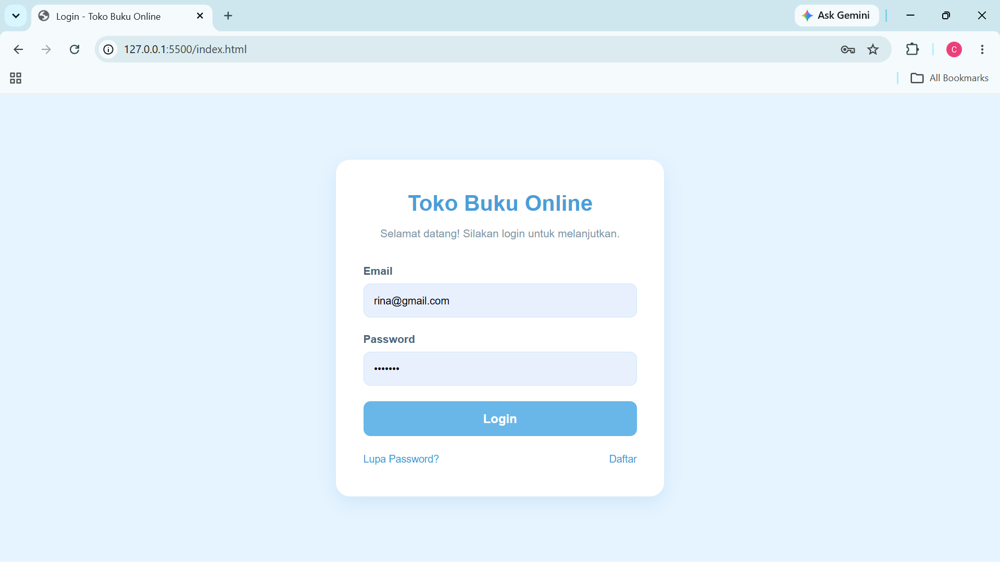
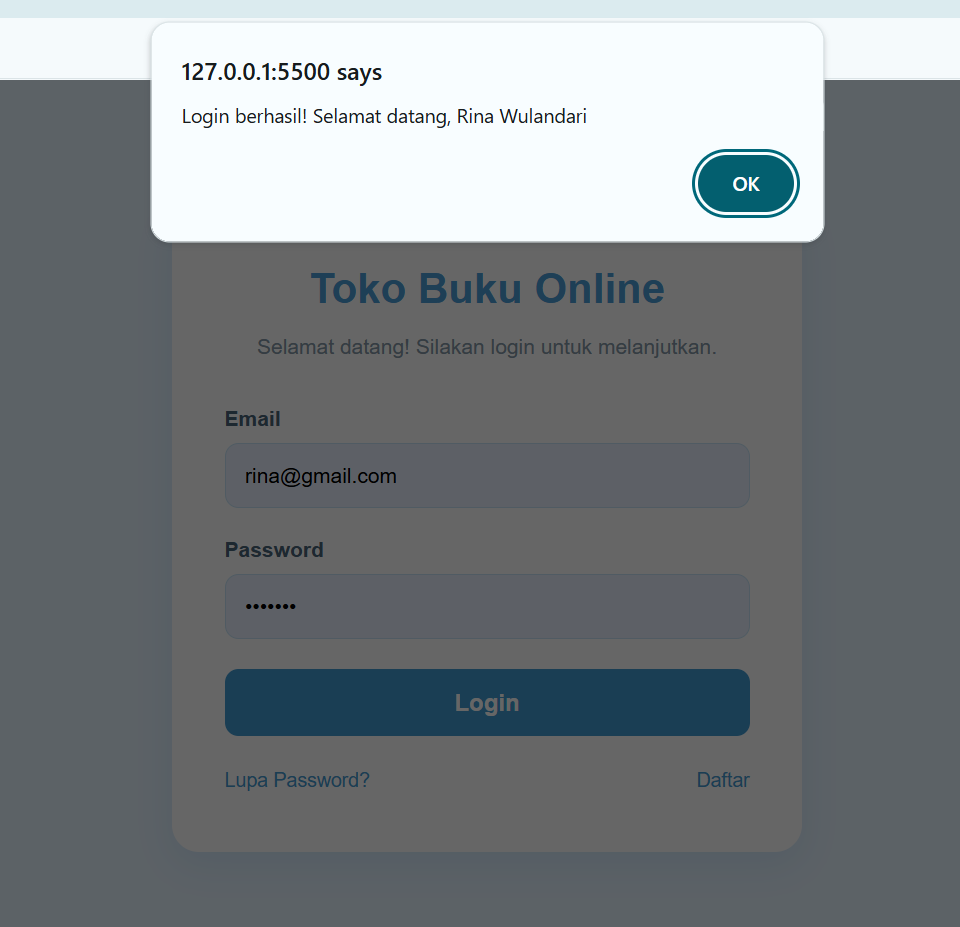
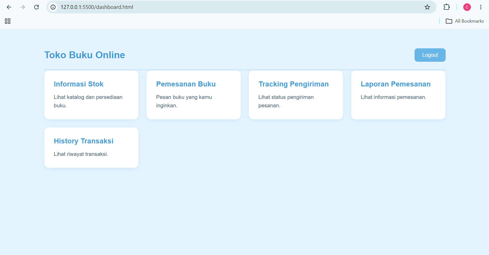
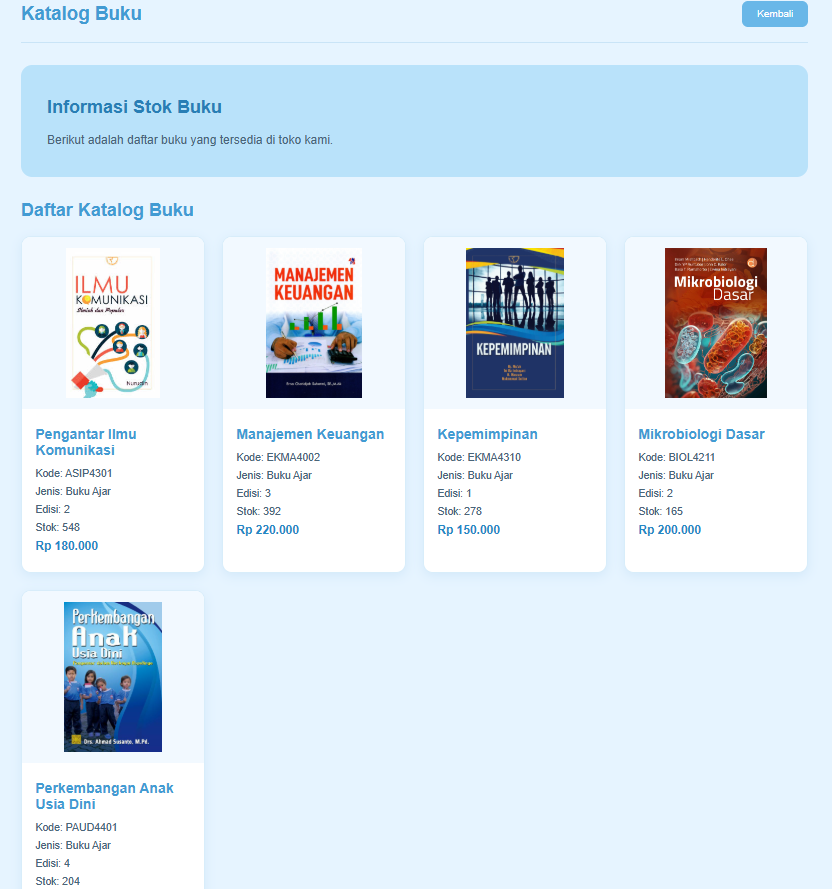
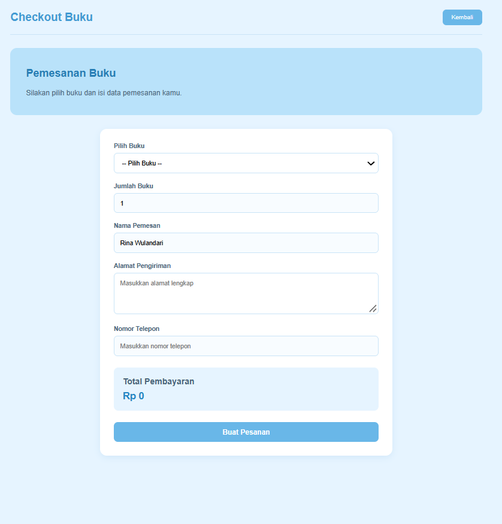
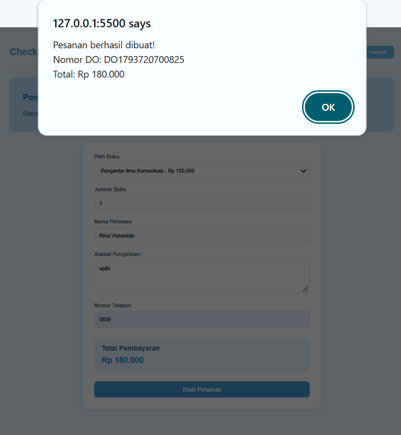
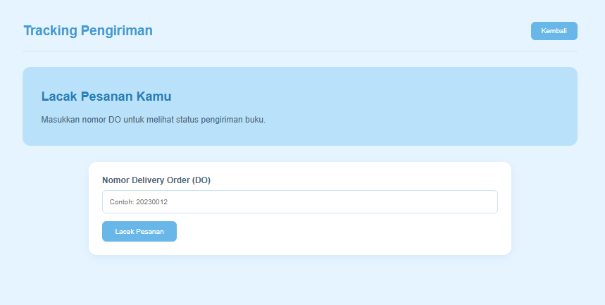
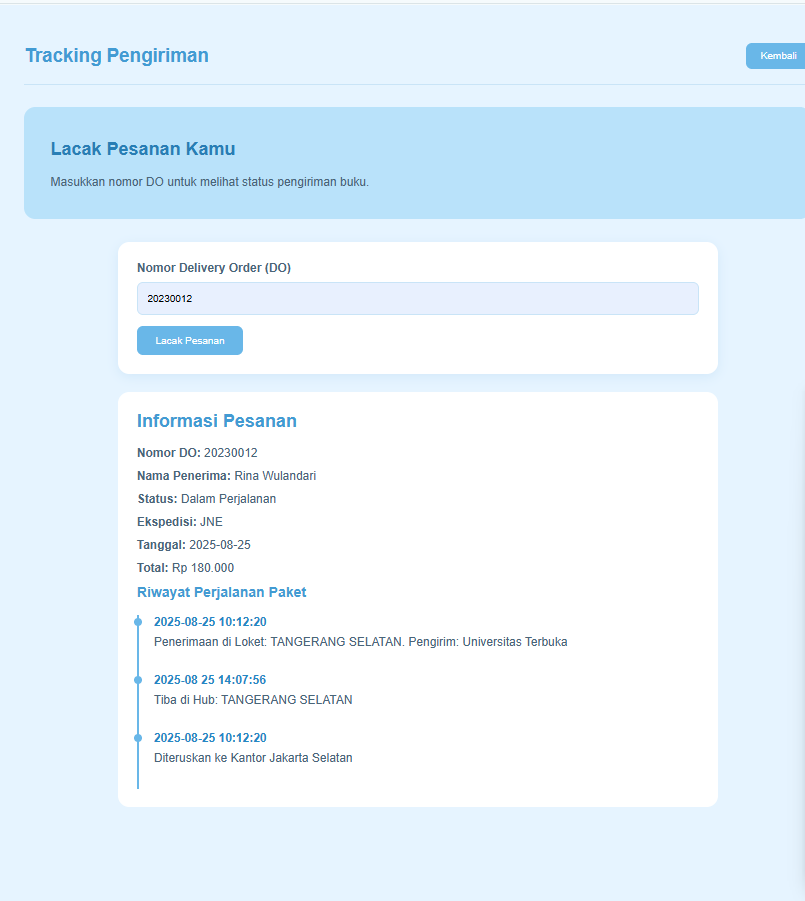
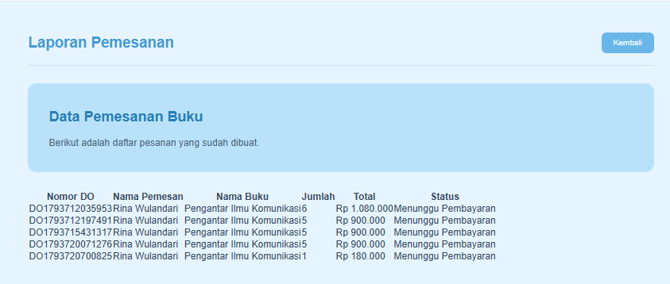

# UTS Pemrograman Web – Toko Buku Online

Aplikasi web sederhana **Toko Buku Online** yang dibuat dengan HTML, CSS, dan JavaScript (tanpa backend). Data pengguna dan katalog disimpan di `data.js`, sedangkan data login dan pesanan disimpan di `localStorage` browser.

## 🎥 Video Presentasi

[Tonton di YouTube](https://youtu.be/0iV1AlnTlWc?si=2J4E6vyBcLZzjOYA)

## Fitur

- Login dengan validasi email dan password
- Dashboard dengan sapaan sesuai waktu dan tombol logout
- Informasi stok (katalog buku + form tambah buku)
- Pemesanan buku (checkout dengan hitung total otomatis)
- Tracking pengiriman berdasarkan Nomor DO
- Laporan pemesanan
- History transaksi

## Struktur Folder

```
UTS PEMROGRAMAN WEB 1/
├── index.html          # Halaman login
├── dashboard.html      # Menu utama setelah login
├── stok.html           # Informasi stok / katalog buku
├── checkout.html       # Pemesanan buku
├── tracking.html       # Tracking pengiriman
├── laporan.html        # Laporan pemesanan
├── history.html        # History transaksi
├── CSS/
│   └── style.css       # Seluruh styling halaman
├── JS/
│   ├── data.js         # Data pengguna, katalog buku, dan data tracking
│   └── script.js       # Logika login, katalog, checkout, tracking, laporan, history
└── img/                # Cover buku
    ├── pengantar_komunikasi.jpg
    ├── manajemen_keuangan.jpg
    ├── kepemimpinan.jpg
    ├── mikrobiologi.jpg
    └── paud_perkembangan.jpeg
```

## Cara Menjalankan

1. Buka folder proyek di VS Code.
2. Jalankan `index.html` dengan ekstensi **Live Server** (klik kanan → *Open with Live Server*).
3. Browser akan membuka `http://127.0.0.1:5500/index.html`.

## Akun untuk Login

| Nama | Email | Password | Role |
|------|-------|----------|------|
| Rina Wulandari | rina@gmail.com | rina123 | User |
| Agus Pranoto | agus@gmail.com | agus123 | User |
| Siti Marlina | siti@gmail.com | siti123 | Admin |

## Langkah Login dan Outputnya

### 1. Buka halaman login
Buka `index.html`. Form berisi kolom **Email**, **Password**, tombol **Login**, serta tautan *Lupa Password?* dan *Daftar*.



### 2. Isi email dan password
Masukkan email dan password yang terdaftar, contoh `rina@gmail.com` dan `rina123`, lalu klik **Login**.

### 3. Sistem memvalidasi data
Fungsi `prosesLogin()` di `script.js` mencocokkan input dengan `dataPengguna` di `data.js`.

- **Jika cocok**, muncul alert `Login berhasil! Selamat datang, Rina Wulandari`. Data pengguna disimpan ke `localStorage` (`penggunaLogin`).
- **Jika tidak cocok**, muncul alert `Email/password yang anda masukkan salah` dan pengguna tetap di halaman login.



### 4. Diarahkan ke dashboard
Setelah menekan **OK**, pengguna otomatis dialihkan ke `dashboard.html`, yang menampilkan menu Informasi Stok, Pemesanan Buku, Tracking Pengiriman, Laporan Pemesanan, dan History Transaksi.



### 5. Logout
Klik **Logout**, konfirmasi pada dialog, lalu data `penggunaLogin` dihapus dan pengguna kembali ke `index.html`.

## Tampilan Fitur Lain

### Informasi Stok
Menampilkan katalog buku beserta kode, jenis, edisi, stok, dan harga.



### Pemesanan Buku
Pilih buku, isi jumlah, alamat, dan nomor telepon. Total pembayaran terhitung otomatis.



Setelah menekan **Buat Pesanan**, muncul alert berisi Nomor DO dan total pembayaran.



### Tracking Pengiriman
Masukkan Nomor DO untuk melihat status pengiriman.





### Laporan Pemesanan
Menampilkan daftar pesanan yang sudah dibuat.


